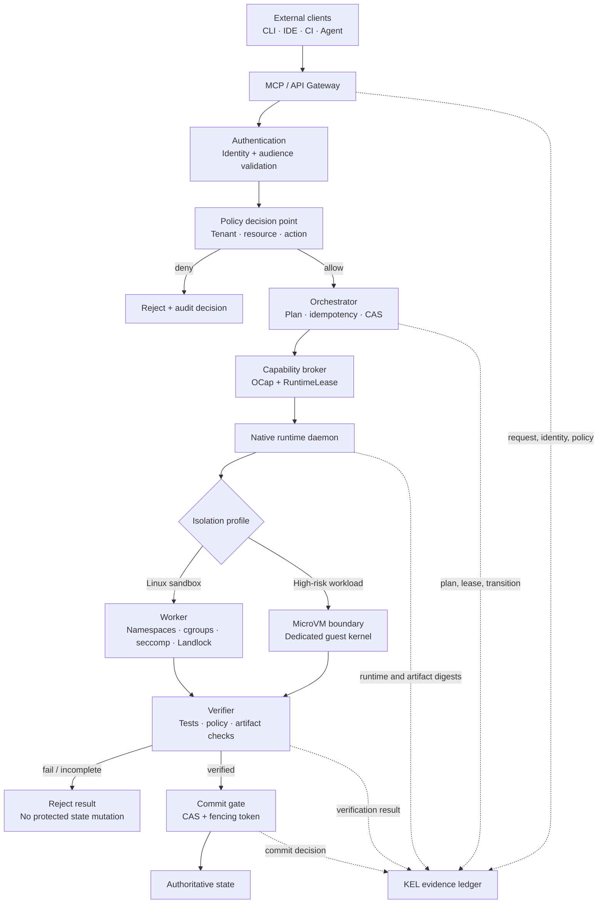
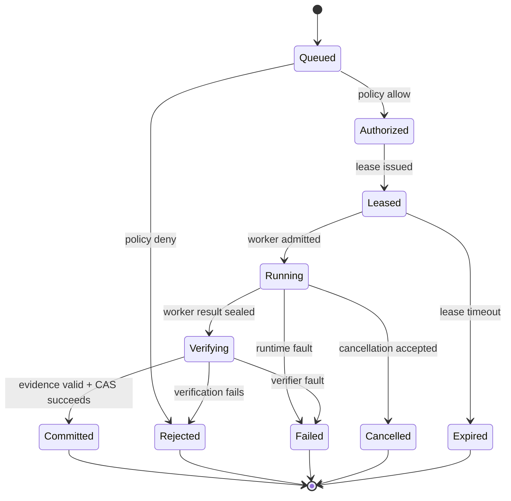

# Klyn OS

**A headless-first, evidence-driven runtime for autonomous software engineering**

[Architecture](#architecture) · [Security model](#security-model) · [Execution contract](#execution-contract) · [MCP integration](#mcp-integration) · [Quickstart](#quickstart)

---

## Purpose

Klyn OS is an autonomous software-engineering runtime. It turns engineering intent into a bounded execution plan, authorizes each operation, runs work inside an isolated environment, verifies the resulting evidence, and commits state only through an explicit, auditable transition.

Klyn OS is **headless-first**. External clients—CLI tools, IDE integrations, CI systems, and agent clients—connect through a controlled API/MCP boundary. The native runtime owns privileged execution. TypeScript services coordinate requests; they do not bypass native security controls.

The design objective is not to make an agent omnipotent. It is to make every agent action **scoped, attributable, revocable, replayable where inputs permit, and rejectable when proof is incomplete**.

> **Design horizon:** “1,000 years ahead” is an engineering ambition for durable interfaces and verifiable invariants—not a claim of literal technological superiority, zero risk, or completed implementation. This repository is in alpha development. The contracts below define the intended security and execution bar; a control is production-ready only when implementation, tests, and release evidence demonstrate it.

## At a glance

| Property | Contract |
|---|---|
| Operating model | Headless-first; API/MCP gateway plus native execution runtime |
| Trust model | Zero trust between clients, agents, control plane, workers, and artifacts |
| Execution | Explicit plans, bounded capabilities, isolated workers, verification before mutation |
| State integrity | Versioned transitions with compare-and-swap (CAS) and fencing |
| Evidence | Content-addressed records and append-only Merkle commitments |
| Default network policy | Deny; explicit destination and protocol grants only |
| Credentials | Secret-brokered, short-lived, scoped; never inferred from prompt text |
| Unsupported platform | Fail closed; no silent downgrade to an unconfined executor |

## Architecture

### Control flow



### Trust boundaries and ownership

| Boundary | Responsibility | Must not be trusted to |
|---|---|---|
| Client / agent | Submit intent and receive scoped results | Grant itself permissions or assert its own verification |
| MCP / API gateway | Authenticate, validate protocol envelopes, rate-limit, route | Execute arbitrary host commands or expose ambient credentials |
| Policy engine | Decide whether a principal may perform an action on a resource | Treat model-generated text as policy |
| Orchestrator | Build plans, issue leases, coordinate idempotent operations | Bypass authorization or mutate protected state outside CAS |
| Native daemon | Enforce local execution policy and launch workers | Trust caller-supplied paths, IDs, environment, or privilege claims |
| Worker / microVM | Execute one bounded workload | Retain authority after lease expiry or reach undeclared resources |
| Verifier | Evaluate outputs against declared acceptance criteria | Modify the candidate result it is verifying |
| Evidence ledger | Commit tamper-evident execution records | Store plaintext secrets or silently rewrite history |

**Authority rule:** the model proposes; the policy engine authorizes; the runtime enforces; the verifier evaluates; the commit gate mutates state. No model response alone is sufficient authority for a protected operation.

### Logical subsystem map

These are ownership boundaries, not a claim that every subsystem is complete or production-qualified.

- **Gateway and protocol adapters:** MCP/HTTP validation, authentication hand-off, rate limits, tool discovery, and response normalization.
- **Control plane:** project and execution coordination, policy decisions, idempotency keys, leases, state transitions, and cancellation.
- **Native runtime:** `klyn-daemon`, `klyn-cli`, worker lifecycle, local policy enforcement, and platform capability detection.
- **Isolation layer:** `klyn-sandbox`, filesystem boundary (`klyn-fs`), resource controls, syscall policy, and optional microVM execution.
- **Execution engine:** `klyn-runtime`, task scheduling, bounded tool invocation, and deterministic transition processing.
- **Evidence layer:** Klyn Evidence Ledger (KEL), artifact digests, attestations, verification records, and audit export.

The native runtime is the enforcement boundary. A gateway or orchestration service may request an operation; it cannot manufacture proof that the native runtime enforced it.

## Execution contract

### 1. Intent is not authority

Every request is normalized into a typed operation containing:

- authenticated principal and tenant;
- target project, repository, and immutable revision;
- declared operation and canonical resource scope;
- input and configuration digests;
- requested tools and network destinations;
- time, CPU, memory, process, and storage budgets;
- verification policy and required approvals;
- idempotency key and expected state version.

Free-form prompt text is untrusted input. It can describe intent, but it cannot add permissions, change tenant identity, weaken policy, or authorize secret access.

### 2. Least-privilege capability tokens

The object-capability contract (**OCap**) grants authority over a specific action and resource—not a broad user session.

A capability must be cryptographically authenticated and bind, at minimum:

- issuer, subject, audience, tenant, and workload identity;
- allowed operation set and canonical resource scope;
- constraints (such as byte limits, destination allowlist, or permitted paths);
- issue time, expiry, unique token identifier, and policy version/digest;
- delegation rules, including maximum depth and attenuated child scopes;
- execution or lease binding where supported.

**Enforcement requirements**

1. No ambient authority: workers receive only capabilities needed for the assigned operation.
2. No privilege amplification: delegated capabilities may only narrow authority.
3. Short lifetime: expiry and revocation are checked at the enforcement point.
4. Audience binding: a token issued for one service or workload is invalid elsewhere.
5. Replay resistance: bind one-shot operations to a nonce or idempotency record.
6. No model minting: agents cannot sign, widen, or self-approve capabilities.
7. No bearer leakage: tokens are never written to prompts, source files, logs, KEL payloads, or tool output.

A token is necessary but not sufficient: the native runtime independently validates the token, current lease, policy version, and requested resource.

### 3. Runtime lease and deterministic state transitions

`RuntimeLeaseV1` is the bounded execution grant. It binds a worker to an execution ID, immutable input snapshot, policy digest, capability set, resource budget, expiry, and fencing generation.

The authoritative state machine is event-driven:



State-machine guarantees:

- Each transition has a typed event, a precondition, an expected version, and an auditable result.
- State writes use compare-and-swap against the expected version. A stale worker cannot overwrite newer state.
- A monotonically increasing fencing generation invalidates prior workers after lease replacement, cancellation, or expiry.
- Repeated requests with the same idempotency key resolve to the same logical operation; conflicting payloads are rejected.
- A worker result is a candidate, not a commit. Only the verifier and commit gate authorize a protected mutation.
- Failure, timeout, or incomplete evidence leaves protected state unchanged.

**Determinism boundary:** Klyn OS does not claim that neural inference is deterministic. Model outputs, remote services, and external systems may vary. The deterministic guarantee applies to the validated state-transition function when given the same canonical prior state, event, policy version, and inputs. Reproduction additionally requires pinned artifacts, tool versions, configuration, and any external responses that affect the result. An execution that cannot be reproduced is marked as such; it is not mislabeled deterministic.

## Isolation and containment

Isolation is selected by workload risk and host capability. The runtime must never silently replace a requested isolation profile with a weaker one.

| Layer | Required control | Enforcement objective |
|---|---|---|
| Process | Dedicated worker identity, PID namespace where available, process limits | Prevent cross-workload process visibility and fork/resource abuse |
| Filesystem | Private mount view, read-only base image, scoped writable workspace, Landlock where supported | Prevent host and sibling-project file access |
| Syscalls | Seccomp-BPF allowlist/profile | Reduce kernel attack surface |
| Resources | cgroups v2 CPU, memory, PIDs, and I/O limits | Bound exhaustion and contain noisy workers |
| Namespaces | User, mount, PID, network, IPC, UTS as supported | Separate workload views and identifiers |
| Network | Deny-by-default egress through an explicit policy proxy | Prevent unapproved exfiltration and lateral movement |
| Strong isolation | MicroVM with a dedicated guest kernel for higher-risk or multi-tenant workloads | Add a guest-kernel boundary between workload and host |

**Fail-closed platform behavior:** the runtime probes the actual kernel and feature ABI before admission. If a required control is unavailable (for example, an unsupported Landlock ABI, namespace, cgroup, or syscall-filter capability), the workload is rejected with a typed unsupported-platform or policy error. It is not run unsandboxed. MicroVM isolation is only claimed when the hypervisor and guest boundary are active and measured; a container is not a microVM.

## Security model

### Security invariants

These are non-negotiable release requirements:

1. **Complete mediation:** every privileged operation is authorized at the point of use.
2. **Least authority:** every worker receives the minimum capability and resource budget for one task.
3. **Tenant isolation:** principal, project, execution, storage, and evidence scopes are checked independently.
4. **Immutable inputs:** execution binds to content digests and immutable revisions, not mutable branch names alone.
5. **No ambient secrets:** credentials are brokered for a narrow purpose and never exposed to the model by default.
6. **Untrusted tool output:** files, logs, web pages, issue text, compiler output, and model responses cannot modify trusted policy.
7. **Verified mutation:** protected state changes only after evidence validation and a successful versioned commit.
8. **Revocable execution:** expiry, cancellation, and policy revocation fence stale workers.
9. **Tamper-evident history:** committed evidence is append-only and cryptographically verifiable.
10. **Fail closed:** missing controls, malformed proofs, ambiguous identity, and unsupported platforms produce rejection—not a permissive fallback.

### Threat and hardening matrix

| Threat | Attack path | Required mitigation | Release evidence |
|---|---|---|---|
| Prompt injection | Malicious instructions embedded in code, docs, web pages, or tool output | Treat retrieved content as data; separate policy from model context; require explicit capability for each tool | Adversarial injection tests show no privilege expansion |
| Tool abuse | Agent invokes a dangerous or out-of-scope tool | Typed tool schemas, per-tool authorization, resource scope, approval gates, bounded execution | Deny tests for unauthorized action/resource combinations |
| Worker escape | Malicious build/test code attacks host kernel or runtime | Namespaces, seccomp, Landlock, cgroups; microVM for elevated-risk workloads | Hostile workload tests, escape regression tests, isolation telemetry |
| Secret exfiltration | Prompt or process attempts to read or transmit credentials | Secret broker, short-lived scoped handles, egress deny-by-default, output redaction | Canary-secret tests; network policy tests; log scans |
| Cross-tenant access | Forged IDs or confused-deputy request crosses tenant boundary | Derive identity from authenticated context; verify tenant/resource binding at every layer | Negative authorization matrix and isolation tests |
| Stale worker / race | Expired worker writes after retry or cancellation | Lease expiry, fencing generation, state-version CAS | Concurrent transition and stale-fence tests |
| Artifact substitution | Build output or dependency replaced after review | Digest-pinned inputs, signed provenance, artifact signature verification | Provenance verification and digest mismatch tests |
| Evidence tampering | Attacker rewrites or truncates execution history | Append-only Merkle commitments, signed checkpoints, inclusion and consistency proofs | Proof verification and tamper-detection tests |
| Resource exhaustion | Fork bomb, memory growth, disk fill, infinite task | cgroups, quotas, wall-clock deadlines, bounded queues, admission control | Stress tests and enforced limit assertions |
| Supply-chain compromise | Dependency, build action, runner, or release artifact altered | Pinned dependencies/actions, protected builds, provenance, signing, reproducible rebuilds | SBOM, provenance, signature, and independent rebuild checks |

### Secret handling

- Store long-lived credentials in a dedicated secret manager, never in repository files or prompts.
- Issue short-lived, audience-bound credentials only to the process that needs them.
- Prefer file-descriptor or broker-mediated access over copying secrets into worker environments.
- Redact authorization headers, tokens, private keys, and secret-bearing output before logging.
- Never include raw secrets in KEL entries; record secret references and access decisions, not values.
- Rotate credentials after suspected exposure and invalidate affected leases.
- Treat environment variables as potentially observable by same-privilege processes and diagnostic tooling.

### Prompt-injection and tool-execution boundary

Retrieved content is untrusted, even when it comes from a repository owned by the current user. Instructions inside a file, web page, commit message, test fixture, or tool result do not become system policy.

The model may propose a tool call. Before execution, the gateway and native runtime validate:

1. authenticated principal and tenant;
2. tool name and schema;
3. resource scope and operation capability;
4. lease validity and policy version;
5. destination, file, and resource constraints;
6. approval requirement for destructive, external, or secret-bearing operations.

High-impact operations—such as publishing a release, deleting data, modifying access controls, or sending data outside the execution boundary—require an explicit policy grant and, where configured, human approval. The model cannot approve its own request.

## Evidence and auditability: KEL

The **Klyn Evidence Ledger (KEL)** records verifiable facts about an execution without becoming a secret store.

An evidence record should include:

- schema version, event type, execution ID, sequence number, and timestamp;
- principal, tenant, policy digest, capability/lease identifiers (or safe digests);
- source revision and canonical input/configuration digests;
- worker image, runtime, toolchain, and dependency digests;
- verification policy, test results, exit classification, and artifact digests;
- previous-record commitment and resulting Merkle checkpoint.

Sensitive values are excluded or irreversibly redacted before commitment. A digest is not a substitute for access control over the underlying artifact.

KEL uses a domain-separated Merkle construction with leaf and internal-node prefixes, and supports:

- **inclusion proofs**: show that a record is committed under a particular root;
- **consistency proofs**: show that a newer checkpoint extends a previously observed tree;
- **signed checkpoints**: bind a root hash and tree size to an authorized signer;
- **independent verification**: verify proofs without trusting the component that produced the record.

The design follows the Merkle inclusion and append-only consistency concepts in [RFC 9162](https://www.rfc-editor.org/rfc/rfc9162.html). The exact hash suite, canonical serialization, key rotation, checkpoint format, and verifier version must be versioned. A Merkle root alone does not prove that an event is truthful; signed identities, trustworthy event capture, and independent verification remain necessary.

## Supply-chain integrity and release gates

Klyn OS treats source, build infrastructure, dependencies, and release artifacts as part of the trusted computing base.

**Required release controls**

- Protect the default branch; require reviewed changes and status checks for privileged code.
- Sign commits and release tags; verify signer identity and signature policy in CI.
- Pin third-party CI actions and build tools to immutable revisions.
- Lock dependencies; record resolved dependency digests and produce an SBOM (SPDX or CycloneDX).
- Generate SLSA-compatible build provenance identifying source revision, builder, build definition, resolved dependencies, and artifact subjects.
- Sign artifacts and attestations; verify them before deployment or execution.
- Rebuild from the same declared inputs in an isolated environment and compare artifact digests where reproducibility is claimed.
- Reject unsigned, unprovenanced, or digest-mismatched production artifacts.

Relevant baselines: [SLSA build tracks](https://slsa.dev/spec/v1.0/levels), [SLSA provenance](https://slsa.dev/spec/v1.1/provenance), [Sigstore](https://docs.sigstore.dev/), and [NIST SP 800-218 SSDF](https://csrc.nist.gov/pubs/sp/800/218/final).

A control is not satisfied by a checklist entry. Its release record must link to the actual CI run, attestation, signature-verification result, test report, or reproducible-build comparison. Do not advertise a SLSA level, signed-build guarantee, or reproducibility guarantee until the corresponding requirements are independently met.

## MCP integration

MCP is a protocol boundary—not a grant of trust. Klyn OS exposes only explicitly registered tools and resources. The exact endpoint URL is deployment-specific and must be supplied by the deployment operator; this README intentionally contains no private deployment address.

### Client connection contract

Provide the client with:

- the deployment's HTTPS MCP endpoint;
- a short-lived bearer credential or supported OAuth flow;
- the expected tenant/project scope;
- the approved tool set;
- the protocol version supported by both client and server.

Store credentials in the client's secret store. Do not place tokens in URLs, source code, checked-in configuration, screenshots, or shell history. Require TLS; reject invalid authorization, unsupported protocol versions, malformed JSON-RPC envelopes, and tool arguments that fail schema validation.

For Streamable HTTP, clients send JSON-RPC requests to the configured MCP endpoint using the transport and protocol version negotiated with the server. Follow the [official MCP specification](https://modelcontextprotocol.io/specification/) for initialization, capability negotiation, tool discovery, invocation, notifications, and transport behavior. Do not assume every server version supports identical session or streaming semantics.

### Tool invocation contract

A tool call is accepted only after authentication, schema validation, policy evaluation, and capability checks. Tool implementations must:

- use stable, versioned tool names and JSON schemas;
- reject unknown fields where strict validation is required;
- enforce tenant and resource scope server-side;
- impose deadlines, payload limits, and rate limits;
- use idempotency keys for mutating operations;
- return a typed result with operation ID, state, and evidence reference;
- return structured errors without leaking secrets or host details.

Suggested response envelope (illustrative contract, not a claim that every tool currently emits this exact shape):

```json
{
  "operation_id": "op_...",
  "state": "accepted",
  "result": null,
  "evidence": {
    "record_id": "kel_...",
    "checkpoint": "sha256:..."
  }
}
```

Suggested error classes: `UNAUTHENTICATED`, `FORBIDDEN`, `INVALID_ARGUMENT`, `POLICY_DENIED`, `LEASE_EXPIRED`, `CONFLICT`, `RESOURCE_LIMIT`, `UNSUPPORTED_PLATFORM`, `VERIFICATION_FAILED`, and `INTERNAL`. Error messages are diagnostic; authorization decisions use stable machine-readable codes.

### Native runtime boundary

Gateway-to-daemon communication must use an authenticated local channel with explicit peer identity and a versioned message schema (for example, JSON-RPC over a Unix domain socket). The daemon independently validates the request, capability, lease, input digest, and platform policy. The gateway must not invoke an unrestricted host shell through a generic proxy method.

## Quickstart

### Get the repository

```bash
git clone https://github.com/usmanmuhd958-oss/klyn-os.git
cd klyn-os
```

### Inspect the available workspace commands

The repository's package scripts and Rust workspace metadata are authoritative; do not assume a command exists simply because it appears in a tutorial.

```bash
pnpm install --frozen-lockfile
pnpm run
cargo metadata --no-deps --format-version 1
```

Run only the build, test, lint, and qualification scripts declared by the checked-out revision. Native sandbox qualification requires a supported Linux host and the required kernel features; unsupported platforms must report an explicit unsupported result rather than silently running an unconfined worker.

### Connect an MCP client

Configure the HTTPS endpoint and credential through the client or deployment secret manager:

- `KLYN_MCP_URL`: deployment-provided MCP endpoint.
- `KLYN_MCP_TOKEN`: short-lived bearer credential, when bearer authentication is enabled.

Do not commit these values. Do not paste the token into a prompt or a README. Use the deployment's published protocol and authorization configuration; endpoint path and supported protocol version are deployment-specific.

## Repository and change ownership

The logical ownership map is:

| Area | Owns | Must not own |
|---|---|---|
| Gateway | MCP/HTTP protocol, request validation, auth hand-off | Host-level execution authority |
| Control plane | Plans, policy decisions, leases, CAS state | Direct unconfined process execution |
| Native daemon | Worker admission, local enforcement, lifecycle | Tenant policy inferred from prompt text |
| Sandbox / filesystem | Isolation profiles and resource boundaries | Cross-tenant data access |
| Runtime | Scheduling, task protocol, cancellation, result sealing | Silent policy relaxation |
| Verifier | Acceptance checks and proof validation | Mutating the candidate it checks |
| KEL | Append-only evidence commitments | Plaintext credential storage |

Keep privileged enforcement in the smallest reviewable native surface. Protocol adapters and orchestration code should remain replaceable without weakening the local enforcement contract.

## Qualification strategy

A release candidate is not qualified merely because it compiles. The qualification suite should cover:

- unit tests for capability parsing, authorization, canonicalization, and state transitions;
- property tests for CAS, idempotency, lease expiry, fencing, and transition monotonicity;
- fuzzing for protocol frames, parsers, token claims, and evidence records;
- adversarial tests for prompt injection, path traversal, symlink races, malformed tool arguments, and cross-tenant identifiers;
- Linux integration tests for namespaces, cgroups v2, seccomp-BPF, Landlock, and filesystem restrictions;
- microVM tests on hosts that actually provide the required virtualization support;
- concurrency and fault-injection tests for cancellation, retry, worker crash, and partial commit;
- KEL inclusion/consistency proof tests and independent verifier checks;
- supply-chain verification for signatures, SBOMs, provenance, and reproducible-build claims.

Every security-sensitive test must fail closed: a skipped test is not a passing control. Reports must distinguish `PASS`, `FAIL`, `UNSUPPORTED`, and `NOT_RUN`.

## Non-goals and honest limits

- Klyn OS does not promise deterministic model inference or perfect semantic correctness.
- A Merkle commitment does not prove that recorded facts were true when captured.
- Containers and namespaces are not equivalent to a separate guest kernel.
- Cryptographic signatures establish integrity and signer identity only to the extent that keys and identity policy are trustworthy.
- Human approval does not replace runtime authorization or isolation.
- No architecture can eliminate every kernel, hypervisor, hardware, side-channel, dependency, or operator risk.

Klyn OS aims to make those risks explicit, bounded, observable, and testable—not to conceal them behind claims of autonomy.

## Architectural references

- [Model Context Protocol specification](https://modelcontextprotocol.io/specification/)
- [RFC 9162 — Certificate Transparency Version 2.0](https://www.rfc-editor.org/rfc/rfc9162.html)
- [SLSA build track](https://slsa.dev/spec/v1.0/levels)
- [SLSA provenance](https://slsa.dev/spec/v1.1/provenance)
- [Sigstore documentation](https://docs.sigstore.dev/)
- [NIST SP 800-218 — Secure Software Development Framework](https://csrc.nist.gov/pubs/sp/800/218/final)

---

**Klyn OS — Intent → Authorization → Isolated Execution → Verification → Evidence → State Transition.**
